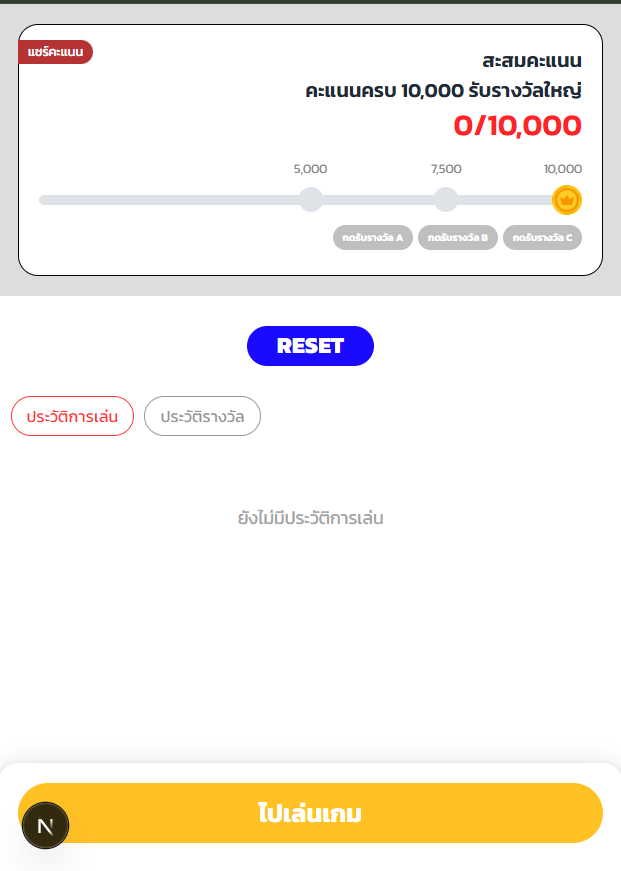

# เกมสะสมคะแนน Nextzy

เว็บแอปเกมสะสมคะแนน: ผู้เล่นกดสุ่มคะแนน สะสมให้ถึง checkpoint แล้วกดรับรางวัล

| | ลิงก์ |
|---|---|
| Website | _TODO: Vercel URL_ |
| API Docs (Swagger, ยิงทดสอบได้) | _TODO: Render URL_/docs/ |

## Features

**หน้า Home**
- แสดงคะแนนสะสม (0 – 10,000) และ progress bar
- Checkpoint 3 ระดับ: 5,000 (รางวัล A), 7,500 (รางวัล B), 10,000 (รางวัล C)
- กดรับรางวัลเมื่อคะแนนถึงเกณฑ์ ขึ้น modal และรับซ้ำไม่ได้
- ประวัติ 2 tab: ประวัติการเล่น และประวัติรางวัล
- ปุ่ม Reset สำหรับเริ่มทดสอบใหม่

**หน้า Game**
- สุ่มคะแนน 300 / 500 / 1,000 / 3,000 โดยตัดตัวเลือกทิ้งทีละตัวจนเหลือคะแนนที่ได้
- ขึ้น modal บอกคะแนนที่ได้ ปิดแล้วเล่นต่อได้ทันที
- คะแนนเต็ม 10,000 แล้วสุ่มต่อไม่ได้

**ทั่วไป**
- Responsive สำหรับมือถือ (300–500px) และ tablet
- มี loading state (skeleton) และ error state (ปุ่มลองใหม่, toast) ทุกจุดที่เรียก API

## Tech Stack

| ส่วน | เทคโนโลยี |
|---|---|
| Frontend | Next.js 16, React 19, TypeScript, Tailwind CSS v4 |
| Backend | Go 1.27 (`net/http`), Gorm |
| Database | PostgreSQL (Supabase) |
| API Docs | OpenAPI 3 + Swagger UI |

## Architecture

```
Browser ──▶ Next.js (frontend) ──HTTP/JSON──▶ Go API (backend) ──Gorm──▶ PostgreSQL
```

### Backend: Clean Architecture

```
backend/
├── cmd/api/                  entrypoint: ประกอบทุก layer เข้าด้วยกัน
├── internal/
│   ├── domain/               กฎของเกม (cap 10,000, checkpoint) ไม่พึ่ง DB/HTTP
│   ├── application/          use cases + Repository interface
│   ├── infrastructure/       Gorm + PostgreSQL
│   └── transport/http/       handlers, middleware, แปลง error เป็น HTTP status
└── docs/                     openapi.yaml + Swagger UI
```

dependency ชี้เข้าหา `domain` ทางเดียว จึงเปลี่ยน DB หรือ transport ได้โดยไม่ต้องแก้ business logic

### Frontend

```
frontend/src/
├── app/            routes (Home `/`, Game `/game`)
├── features/       หน้าจอ + component เฉพาะของแต่ละหน้า
├── components/ui/  component ที่ใช้ร่วมกัน (Button, Modal, Toast, ...)
├── services/       GameService: จุดเดียวที่หน้าจอใช้ดึงข้อมูล
├── hooks/          useAsyncData (loading / error / retry)
└── lib/            api-client, format, player-id
```

### Design Decisions
- **สุ่มคะแนนที่ server:** animation ฝั่ง frontend เป็นแค่ภาพ กันการโกงคะแนน
- **ระบุผู้เล่นด้วย guest id:** ไม่มีระบบ login จึงสร้าง UUID เก็บใน localStorage แล้วส่งทาง header `X-Player-Id` ผู้ทดสอบหลายคนใช้พร้อมกันได้โดยข้อมูลไม่ปนกัน
- **Checkpoint ไม่หักแต้ม:** เป็นเกณฑ์ปลดล็อกตาม requirement ("คะแนนถึงหรือเกิน checkpoint")
- **กันรับรางวัลซ้ำ 2 ชั้น:** ตรวจใน domain และมี unique index `(player_id, checkpoint_score)` ใน DB
- **กัน race condition:** ล็อกแถวผู้เล่น (`SELECT ... FOR UPDATE`) ใน transaction ตอนเล่นและรับรางวัล

## API

| Method | Path | คำอธิบาย |
|---|---|---|
| GET | `/api/players/me/summary` | คะแนนสะสม + สถานะ checkpoint |
| GET | `/api/players/me/plays` | ประวัติการเล่น |
| GET | `/api/players/me/rewards` | ประวัติรางวัล |
| POST | `/api/game/play` | สุ่มคะแนน |
| POST | `/api/rewards/{score}/claim` | รับรางวัล checkpoint |
| POST | `/api/players/me/reset` | รีเซตข้อมูล |

ทุก request ต้องมี header `X-Player-Id: <uuid>` ดูรายละเอียดเต็มได้ที่ `/docs/`

## Getting Started

**สิ่งที่ต้องมี:** Node.js 20+, Go 1.22+, PostgreSQL (หรือ Supabase)

### 1. Backend

```bash
cd backend
cp .env.example .env      # ใส่ DATABASE_URL
go run ./cmd/api          # http://localhost:8080 (Swagger: /docs/)
```

| Env | คำอธิบาย | Default |
|---|---|---|
| `DATABASE_URL` | PostgreSQL connection string (Supabase ใช้ Session pooler) | required |
| `PORT` | port ของ server | `8080` |
| `CORS_ORIGINS` | origin ของ frontend ที่อนุญาต (คั่นด้วย `,`) | `http://localhost:3000` |

ตารางจะถูกสร้างอัตโนมัติตอนเริ่ม server (Gorm AutoMigrate)

### 2. Frontend

```bash
cd frontend
cp .env.example .env.local   # NEXT_PUBLIC_API_URL=http://localhost:8080
npm install
npm run dev                  # http://localhost:3000
```

> ถ้าไม่ได้ตั้ง `NEXT_PUBLIC_API_URL` frontend จะใช้ mock ในเบราว์เซอร์แทน API

### Tests

```bash
cd backend && go test ./...
```


